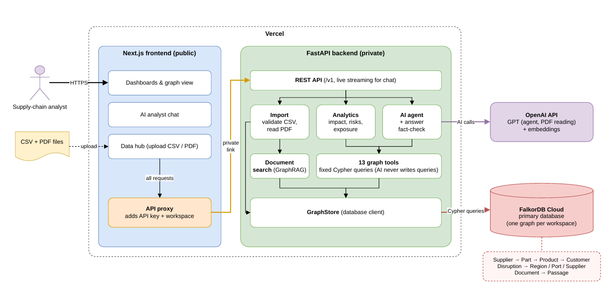

# 🕸️ SupplyGraph

**Supply-chain risk intelligence on a FalkorDB knowledge graph.**

🔗 **Live demo:** [supplygraph-nu.vercel.app](https://supplygraph-nu.vercel.app) (password protected; for access, contact [sammitraut07@gmail.com](mailto:sammitraut07@gmail.com))

---

## 📖 Introduction

SupplyGraph maps a manufacturer's whole supply network as a graph: suppliers, parts, the bill of materials, products, customers, regions, ports and disruptions. You load it from ERP-style CSV extracts and feed it supplier notices and risk bulletins as PDFs. It then answers the questions a risk team asks every day:

- 💥 **What breaks** when a port closes, a region floods or a supplier fails?
- ⏳ **How soon:** how many days of inventory cover remain?
- 💰 **How much** revenue is at risk, and from which customers?
- 🔁 **Who can cover:** which alternate suppliers exist, and are they hit too?

It is more than a chatbot: there are dashboards, an interactive network view, a what-if simulator, a risk register and a data hub, plus an AI analyst panel whose claims are all backed by graph queries.

## 🎯 Objective

Give supply-chain teams one place to see disruption impact across **every tier** of the network, with numbers they can trust. No figure is made up: each one comes from a traversal of the graph.

## 💡 Motivation

Supply-chain risk usually hides several tiers down. In the sample network an EV sedan depends on a cobalt refinery in Katanga only through *cobalt sulfate → cathode → cell → module → pack → car*. Spreadsheets and relational tables struggle to follow chains like that. A graph database follows them naturally.

---

## 🏗️ Architecture



---

## ⚙️ Technical specifications

| Layer | Technology |
|---|---|
| 🖥️ Frontend | Next.js 16 (App Router), React 19, TypeScript, Tailwind CSS v4, SWR, react-force-graph-2d, Recharts |
| 🐍 Backend | Python 3.12, FastAPI, Pydantic v2, server-sent events for streaming |
| 🕸️ Graph database | **FalkorDB Cloud** (Cypher over the Redis protocol, `falkordb` async client) |
| 🤖 AI | OpenAI Responses API (tool calling, PDF reading with structured output), `text-embedding-3-small` embeddings |
| ☁️ Hosting | Vercel Services: a public Next.js service and a private FastAPI service, joined by a service binding |
| 🔌 Extras | MCP server (same tools over stdio) and a `supplygraph` CLI |

### 🔍 How it works

1. **🗂️ Create a workspace.** Use the workspace switcher in the header to create a new workspace, for example one per business unit or scenario. Each workspace is its own FalkorDB graph (`supplygraph:<name>`), so data never mixes between them. The graph is created on the first import, and the `demo` workspace comes ready with sample data and PDFs.
2. **📥 Import data.**
   - **CSV:** upload ERP-style files in the **Data hub**. They are validated and written to FalkorDB. **Merge** updates records by id; **replace** builds a staging graph and swaps it in with `GRAPH.COPY`. Templates for every file can be downloaded from the Data hub.

     **📋 CSV rules**
     - **Files are recognised by their header row**, not their file name, and columns can be in any order.
     - **Format:** UTF-8 or Windows-1252 text. Separators can be comma `,`, semicolon `;`, tab or pipe `|`. Up to 4 MB per upload and 200,000 rows per file.
     - **Required datasets:** `locations`, `suppliers`, `items`, `bom`, `sourcing`. **Optional:** `shipping_lanes`, `customers`, `sales`, `risk_events`.

       | Dataset | Columns (*optional in italics*) | Rules |
       |---|---|---|
       | `locations` | location_id, location_type, name, country_code, *parent_location_id* | `location_type` is `REGION` or `PORT`; a port's `parent_location_id` must be a region; ISO 3166-1 country codes |
       | `suppliers` | supplier_id, supplier_name, location_id, *risk_score* | `location_id` must be a region; `risk_score` 0–1 |
       | `items` | item_id, item_name, item_type, *category*, *days_on_hand* | `item_type` is `FINISHED_GOOD`, `COMPONENT` or `RAW_MATERIAL`; `days_on_hand` 0–3650 |
       | `bom` | parent_item_id, component_item_id, quantity_per | both items must exist; a finished good can't be a component; no cycles in the bill of materials |
       | `sourcing` | supplier_id, item_id, lead_time_days, allocation_pct, *unit_price*, *currency* | `lead_time_days` 0–730; `allocation_pct` 0–100, and an item's suppliers can't add up to more than 100% |
       | `shipping_lanes` | supplier_id, port_id | `port_id` must be a `PORT` location |
       | `customers` | customer_id, customer_name, *segment* | |
       | `sales` | item_id, customer_id, annual_revenue, *currency* | revenue ≥ 0; only sales of finished goods count towards revenue at risk |
       | `risk_events` | event_id, title, category, severity, start_date, *expected_end_date*, status, affected_ids | `severity` 1–5; ISO dates (`2026-10-12`), end not before start; `status` is `ACTIVE` or `RESOLVED`; `affected_ids` is a `;`-separated list of region, port or supplier ids |

     - **Integrity checks:** ids are unique, every reference points to an existing record, and currencies match the workspace base currency (USD by default).
     - **Every problem is reported** with its file, row and column, and nothing is written until the whole upload is valid. Use **Validate** to check files without importing.
   - **PDF:** upload a risk document. The AI reads it, links the names it finds to entities in the graph, and shows you a proposal. Nothing is saved until you approve it. On approval, the disruption is created, and the text is split into passages, embedded and stored in the same graph (GraphRAG).
3. **📊 Explore.** Dashboards, the network view, the simulator and the risk register call fixed graph queries through the backend REST API.
4. **💬 Ask the AI analyst.**
   - The model chooses from **13 graph tools**, such as *disruption impact*, *alternate suppliers* and *trace connection*, and passes typed arguments. **It never writes Cypher.**
   - Each tool first resolves names using the full-text index, then runs a fixed, parameterised query. It returns an explicit outcome: `answered`, `not_in_graph`, `unknown_entity`, `ambiguous` or `from_memory`.
   - Progress streams to the browser live.
5. **✅ Fact-check.** Before the answer is shown, every entity name and money figure in it is checked against the tool results. If something isn't backed by the graph, the answer is replaced with the raw graph results.
6. **🔒 Security.**
   - The browser only talks to Next.js. Its API proxy adds a shared secret and the workspace name, then forwards each request over a private link to the backend, which has no public route.
   - Each workspace is a **separate FalkorDB graph**.

---

## 🕸️ Graph data model

Each workspace is its own graph, `supplygraph:<workspace>`. Every resolvable node has the shared label `Entity` plus its own kind label.

```
(:Supplier)-[:SUPPLIES {lead_time_days, share, unit_cost}]->(:Part)
(:Part)-[:COMPONENT_OF {qty}]->(:Part | :Product)          bill of materials (multi-tier)
(:Product)-[:SOLD_TO {annual_revenue}]->(:Customer)
(:Supplier | :Port)-[:LOCATED_IN]->(:Region)
(:Supplier)-[:SHIPS_VIA]->(:Port)
(:Disruption)-[:AFFECTS]->(:Region | :Port | :Supplier)
(:Document)-[:REPORTS]->(:Disruption)                      PDF provenance
(:Chunk)-[:PART_OF]->(:Document)                           GraphRAG passages
(:Entity)-[:MENTIONED_IN]->(:Chunk)
(:Finding)-[:ABOUT]->(:Entity)                             agent memory
```

**🗂️ Indexes**

| Index | Purpose |
|---|---|
| Unique `Entity.id` | Fast lookup by id |
| Full-text `Entity.name` | Entity resolution and search |
| Vector `Chunk.embedding` (cosine) | Passage search |

---

## 🧮 Cypher queries and graph algorithms

All queries are fixed and parameterised. Model output only ever becomes **parameters** and integer depth limits. Reads use `GRAPH.RO_QUERY` with a server-side timeout.

| Feature | Graph technique |
|---|---|
| 💥 Disruption impact | Disruption → affected region/port/supplier → suppliers knocked out (a supplier with one open export port is *degraded*, not down) → parts → **variable-length BOM walk** `COMPONENT_OF*1..n` → products → customers, revenue at risk, days of cover |
| 🔗 Combined impact | The same traversal with **all active disruptions at once**, to catch parts whose alternate suppliers are knocked out by another event |
| 🔭 Upstream exposure | Product or customer → every supplier at every tier, with country concentration |
| ⚠️ Single points of failure | BOM parts with one supplier or one sourcing country, ranked by downstream revenue |
| 🏭 Supplier criticality | Revenue that depends on each supplier alone vs. its total reach |
| ⏱️ Lead-time critical path | Longest raw-material-to-product chain of supplier lead times |
| 🧭 Connection trace | **`algo.SPpaths`** shortest path between any two entities |
| 🔎 Entity resolution | **`db.idx.fulltext.queryNodes`**: exact id → AND match → OR match |
| 📄 Document search (GraphRAG) | **`db.idx.vector.queryNodes`**, then graph hops to the source document, the disruptions it reported and the entities it mentions |
| 🔄 Replace import | **`GRAPH.COPY`** swaps a validated staging graph into place |

**Example: propagate a lost part up the bill of materials**

```cypher
UNWIND $parts AS pid
MATCH (part:Entity {id: pid})
MATCH path = (part)-[:COMPONENT_OF*1..8]->(prod:Product)
RETURN pid AS part_id, prod.id AS product_id, prod.annual_revenue AS revenue,
       [n IN nodes(path) | {id: n.id, name: n.name}] AS chain,
       reduce(d = 0, n IN nodes(path) | d + coalesce(n.inventory_days, 0)) AS buffer_days
```

**Example: shortest connection between two entities (FalkorDB algorithm)**

```cypher
MATCH (a:Entity {id: $a}), (b:Entity {id: $b})
CALL algo.SPpaths({sourceNode: a, targetNode: b, relTypes: $rels,
                   relDirection: 'both', maxLen: $hops, pathCount: 1})
YIELD path
RETURN [n IN nodes(path) | n.name] AS nodes
```

**Example: GraphRAG passage search (vector index + graph hops)**

```cypher
CALL db.idx.vector.queryNodes('Chunk', 'embedding', $k, vecf32($vector)) YIELD node, score
MATCH (node)-[:PART_OF]->(doc:Document)
OPTIONAL MATCH (doc)-[:REPORTS]->(d:Disruption)
OPTIONAL MATCH (m:Entity)-[:MENTIONED_IN]->(node)
RETURN node.text AS text, doc.filename AS document,
       collect(DISTINCT d.name) AS disruptions, collect(DISTINCT m.name) AS mentions
```

---

## 🚀 Setup

### 🌐 Live app

🔗 **[https://supplygraph-nu.vercel.app](https://supplygraph-nu.vercel.app)**, hosted on Vercel. The app is password protected; for access, contact [sammitraut07@gmail.com](mailto:sammitraut07@gmail.com). Pick the `demo` workspace to explore the sample network, PDFs and live disruptions.

### ✅ Prerequisites

- Python 3.12+ and Node.js 20+
- A **FalkorDB** instance ([FalkorDB Cloud](https://app.falkordb.cloud) free tier works)
- An **OpenAI API key**

### 💻 Run locally

```bash
# 1. Backend
python -m venv .venv
.venv/Scripts/activate                 # macOS/Linux: source .venv/bin/activate
pip install -r backend/requirements.txt   # or, with test tools + CLI: pip install -e "backend[dev]"
cp backend/.env.example backend/.env   # fill in FalkorDB + OpenAI credentials
cd backend && uvicorn main:app --port 8000 --reload

# 2. Frontend (second terminal)
cd frontend && npm ci
cp .env.example .env.local             # BACKEND_URL=http://127.0.0.1:8000 + SUPPLYGRAPH_API_KEY
npm run dev
```

Open 👉 http://localhost:3000, go to **Data hub → Load sample dataset**, and explore.

Sample data (fictional companies, real geography) is in `frontend/public/samples/`: 9 CSVs with 200+ rows each and 6 risk PDFs.

### 🧪 Tests

```bash
cd backend
pytest -m "not integration"   # unit tests
pytest                        # + integration tests against the FalkorDB in backend/.env
```

### 🔌 MCP server

Use the same graph tools from any MCP client:

```json
{ "mcpServers": { "supplygraph": { "command": "supplygraph", "args": ["mcp"] } } }
```
